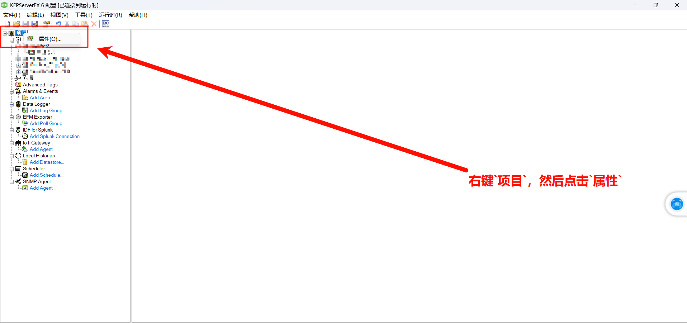
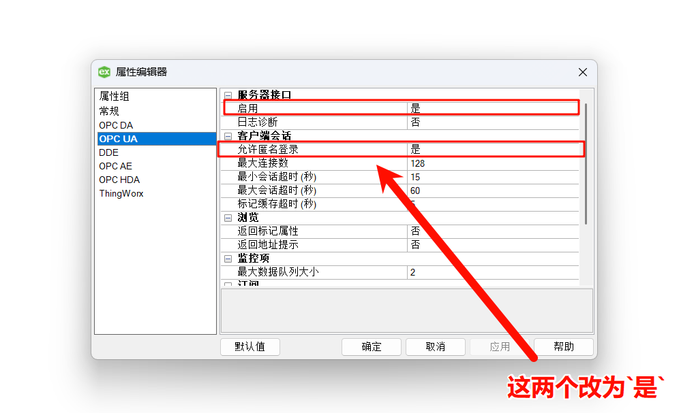
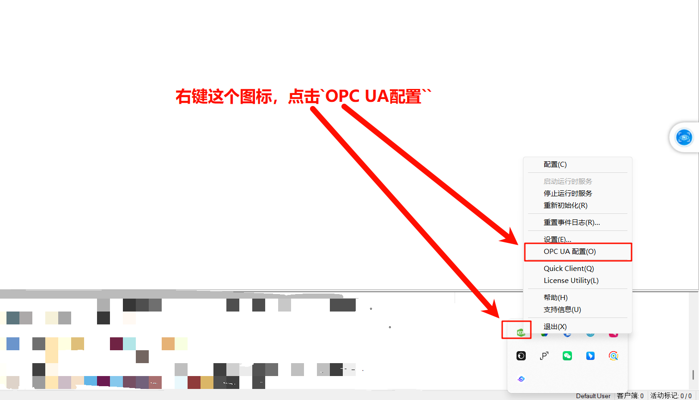
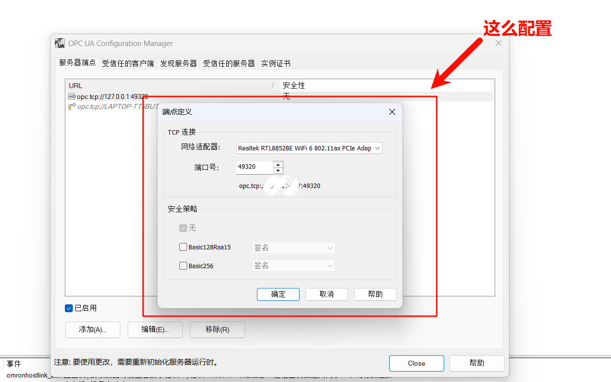
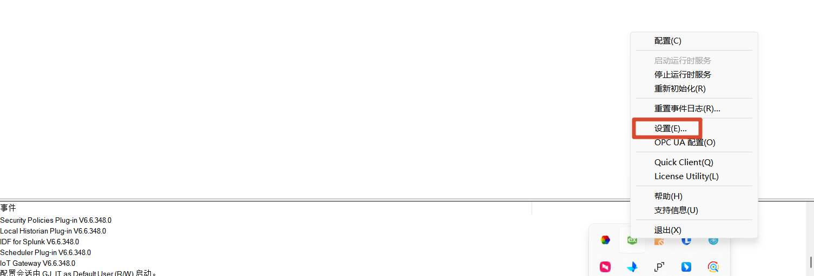
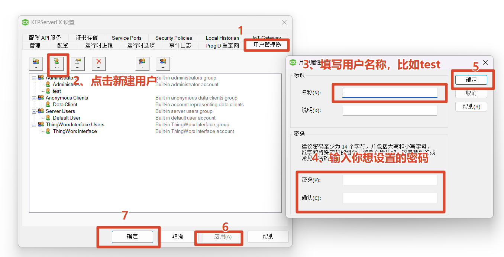
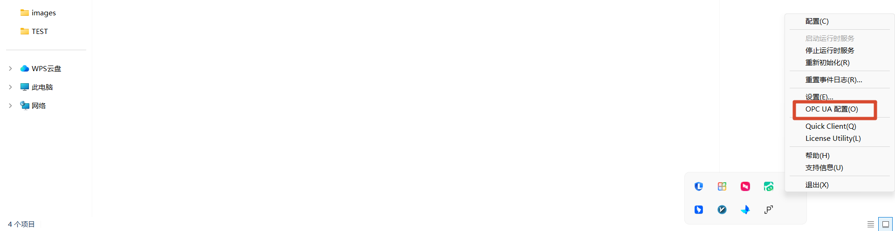
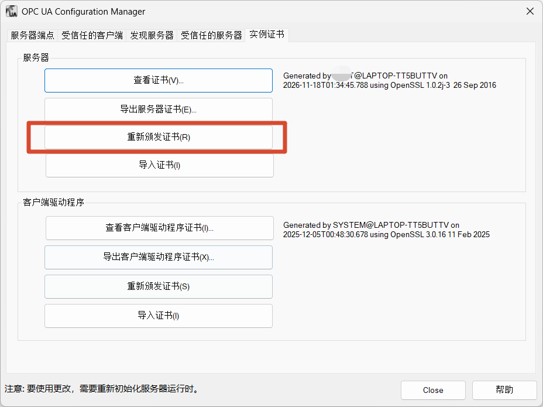

## 安装步骤

安装就是直接一步步点击继续就行。

## 配置OPC UA远程访问链接

在KepServer的配置中，按以下步骤操作：

1. 右键右侧树顶点“项目”
2. 在属性编辑器中 -> 左侧树选择“OPC UA”
3. 在“客户端会话”中将“允许匿名登录”选择“是”
4. 在“服务器接口”中将“启用”选择“是”

## 打开OPC UA配置

右键系统托盘中的KepServer图标，点击 `OPCUA配置`

> **提示**：如果右下角没有KepServer图标，请按以下步骤操作：
> 1. 点击Windows开始按钮
> 2. 在"已固定"区域点击"全部"
> 3. 搜索找到"Kepware"
> 4. 找到"KEPServerEX 6 Administration"图标
> 5. 双击启动，图标就会出现在系统托盘中

## 配置网络适配器

1. 点击 `添加` 按钮
2. 选择网络适配器
3. 安全策略选择 `无`

## 配置密码登录

### 1. 创建用户

右键系统托盘中的KepServer图标，点击 `设置`

在弹出的窗口中切换到 `用户管理器` 选项卡：

1. 点击 `新建用户` 按钮
2. 填写用户名称（比如 `test`）
3. 输入并确认你想设置的密码
4. 点击 `确定`，再依次点击 `应用`、`确定`

### 2. 打开OPC UA配置

右键系统托盘中的KepServer图标，点击 `OPC UA 配置`

### 3. 重新颁发证书（当密码登录一直不行时）

在 `OPC UA Configuration Manager` 窗口中，切换到 `实例证书` 选项卡，点击 `重新颁发证书`，然后重启运行时服务。

> **注意**：窗口底部提示"要使用更改，需要重新初始化服务器运行时"，修改后记得重新初始化。

