## 前言

本文记录在 Windows 电脑上安装 HP Laser MFP 111-117（惠普 A4 纸多功能一体机）驱动的完整过程，
包含两种安装方式：

- **方式一：USB 电缆安装** —— 首次安装时使用，顺便通过 USB 电缆为打印机配置无线网络；
- **方式二：网络安装** —— 打印机已连接到无线网络后，其他电脑直接通过网络搜索安装，无需 USB 线。

## 一、运行驱动安装包

从惠普官网下载对应型号的驱动安装包，双击运行后进入安装向导，
左侧可以看到完整的安装步骤：欢迎 → 正在搜索打印机 → 选择软件 → 安装 → 完成：

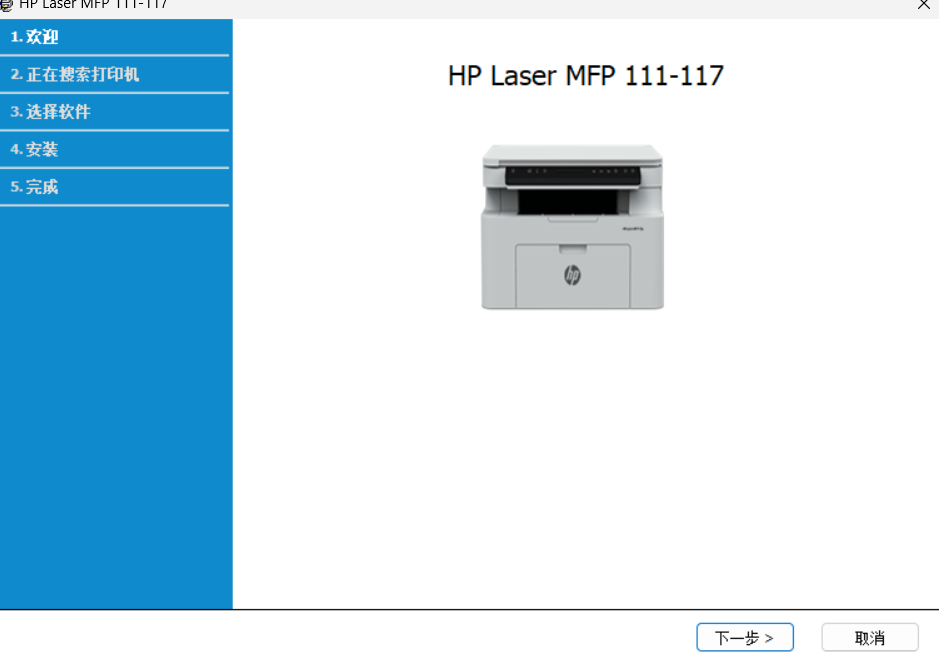

## 二、方式一：通过 USB 电缆为打印机配置无线网络（首次安装）

### 1. 选择打印机连接类型

在「打印机连接类型」页面，选择「无线网络连接」
（将打印机连接到与计算机连接的同一无线网络），点击「下一步」：

### 2. 确认是否第一次安装

如果是第一次设置打印机（或要更改打印机的无线网络配置），
选择「是，我将设置打印机的无线网络」，点击「下一步」：

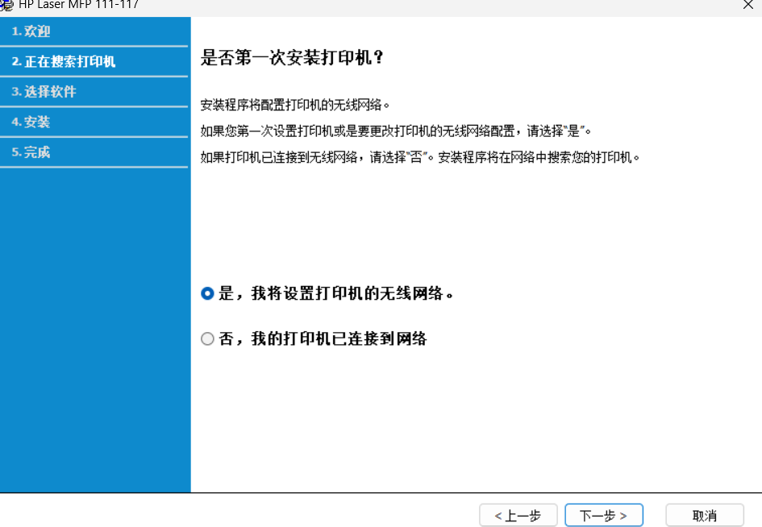

> 如果打印机已经连接到无线网络，选择「否」，安装程序将直接在网络中搜索打印机，
> 也就是下面「方式二」的流程。

### 3. 选择无线设置方法

在「选择无线设置方法」页面，选择「使用 USB 电缆」，
即先用 USB 线连接打印机和电脑，通过 USB 连接为打印机配置无线设置，点击「下一步」：

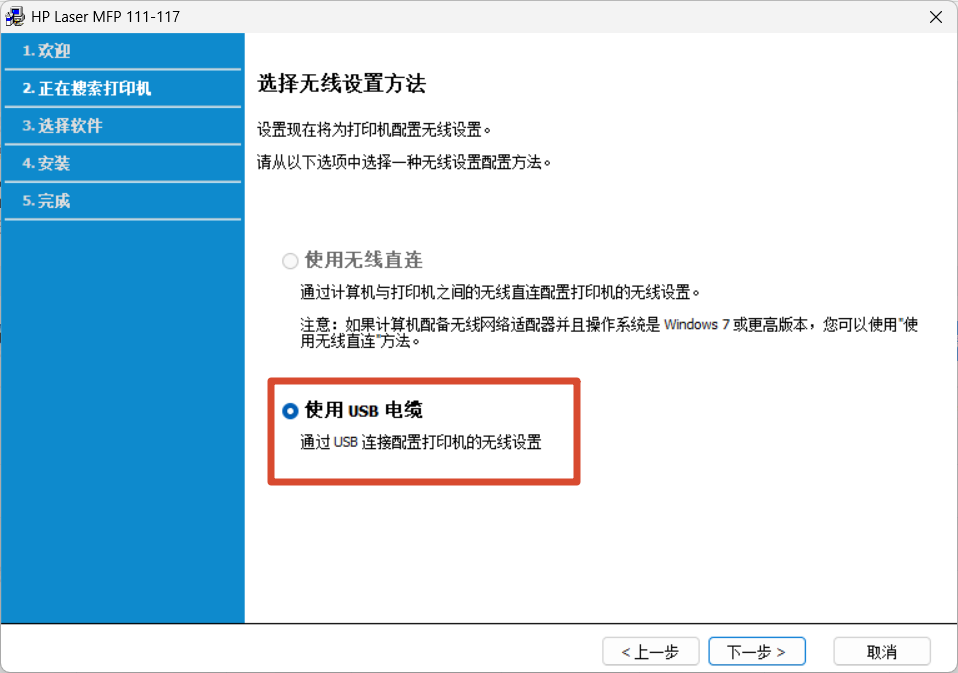

### 4. 选择需要连接的无线网络

安装程序会搜索周围的无线网络，在列表中选择需要连接的网络
（必须选择计算机所连接的同一网络，确保无线路由器已打开），点击「下一步」：

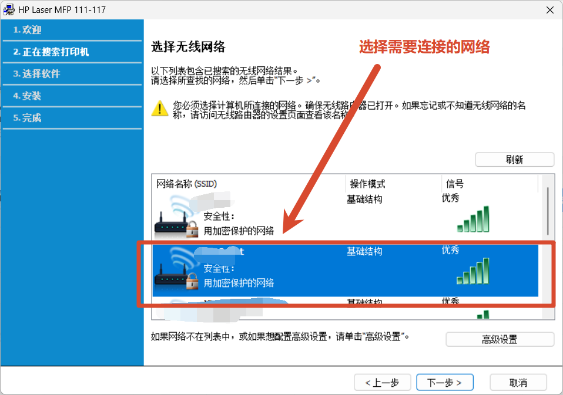

### 5. 输入无线网络密码

在「无线网络安全性」页面，输入所选网络的密码，点击「下一步」开始配置：

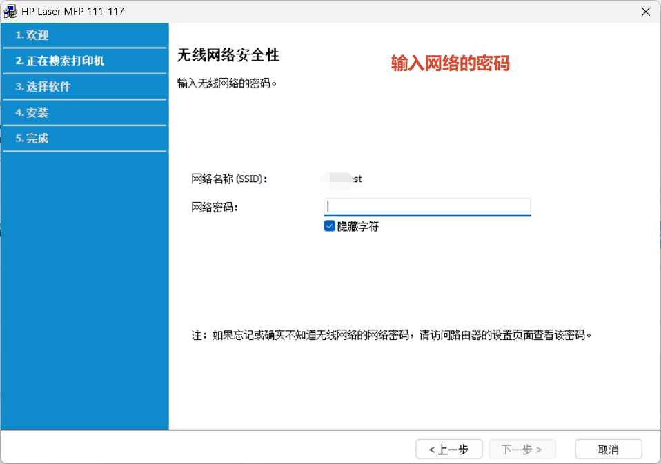

> 如果忘记或不知道无线网络的密码，可以访问无线路由器的设置页面查看。

### 6. 完成无线网络配置

提示「无线网络安装完成」后，安装程序已成功将打印机连接到无线网络。
此时必须**完全断开连接打印机和计算机的 USB 电缆**，拔下后点击「下一步」：

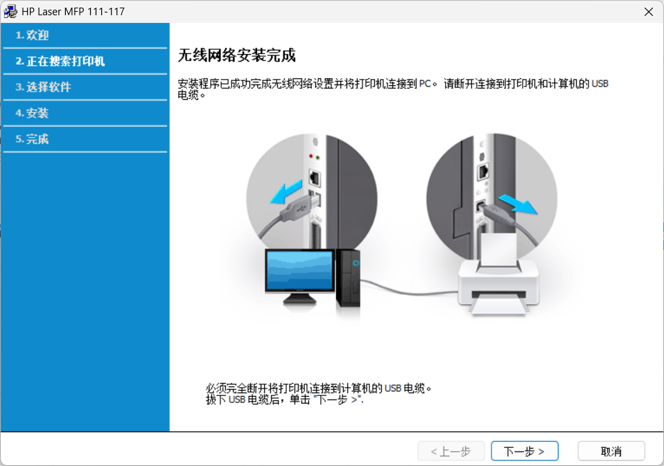

### 7. 选择要安装的软件和实用程序

拔掉 USB 电缆后，安装程序会通过网络搜索到打印机，
进入「选择要安装的软件和实用程序」页面，安装类型保持「建议」，
默认勾选打印机器驱动程序、扫描驱动程序和 HP MFP Scan，点击「下一步」开始安装：

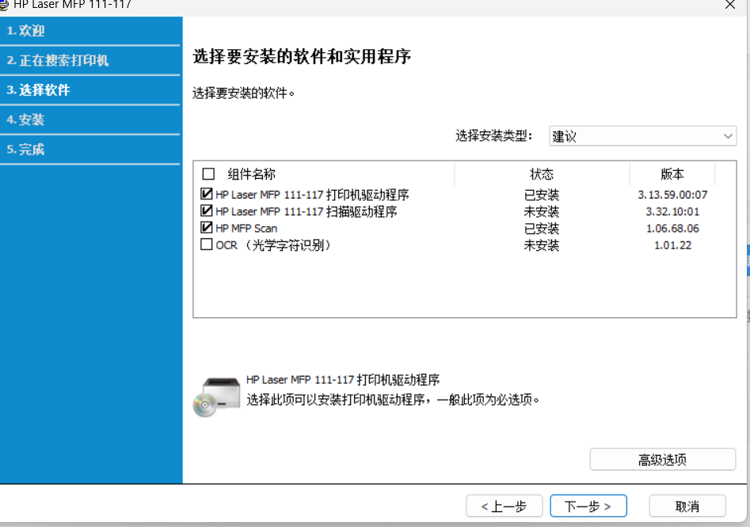

### 8. 完成安装并测试打印

安装完成后，勾选「打印测试页」验证驱动是否安装成功，
也可以按需勾选「启用打印机状态监视器」（从计算机监视打印机状态的软件），点击「完成」：

## 三、方式二：网络安装（打印机已连接到无线网络）

如果打印机已经配置好无线网络（比如用「方式一」配置过），
其他电脑安装驱动时就不需要 USB 线了，直接通过网络搜索安装。

### 1. 选择无线网络连接

在「打印机连接类型」页面，同样选择「无线网络连接」，点击「下一步」：

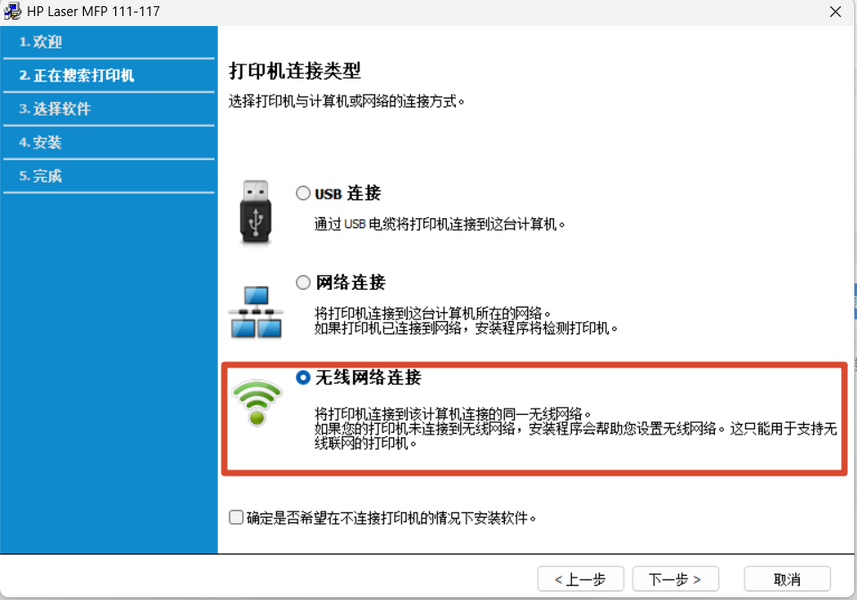

### 2. 选择打印机已连接到网络

在「是否第一次安装打印机？」页面，选择
「**否，我的打印机已连接到网络**」，点击「下一步」：

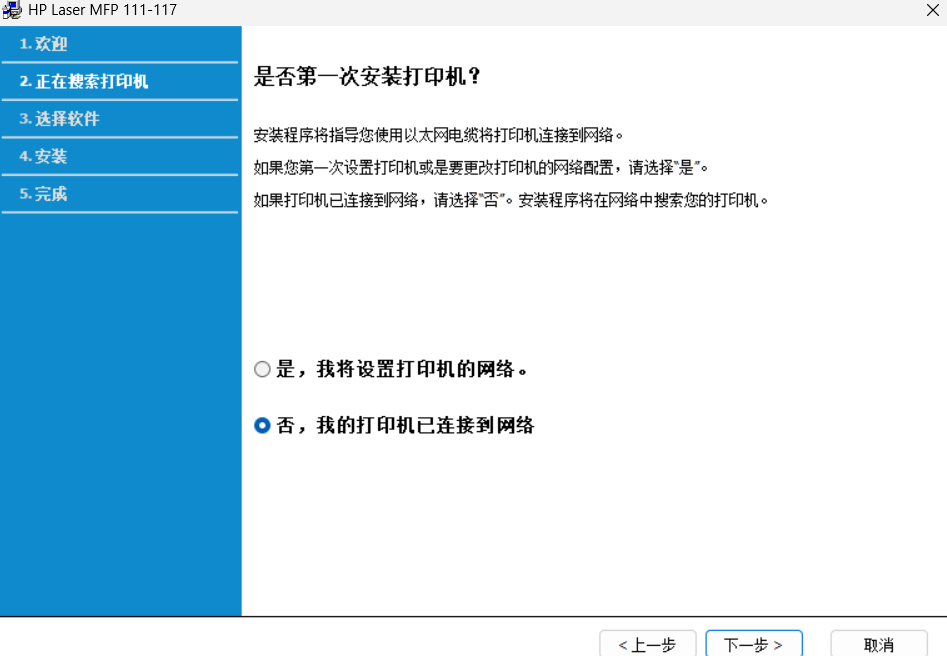

### 3. 自动搜索打印机

安装程序开始自动搜索连接到网络的打印机，等待搜索完成即可：

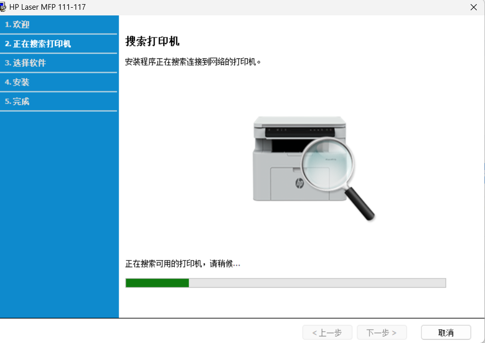

### 4. 选择搜索到的打印机

在「找到了打印机」页面，从列表中选择搜索到的 `HP Laser MFP 111-117`
（可以看到打印机的 IP 地址），点击「下一步」：

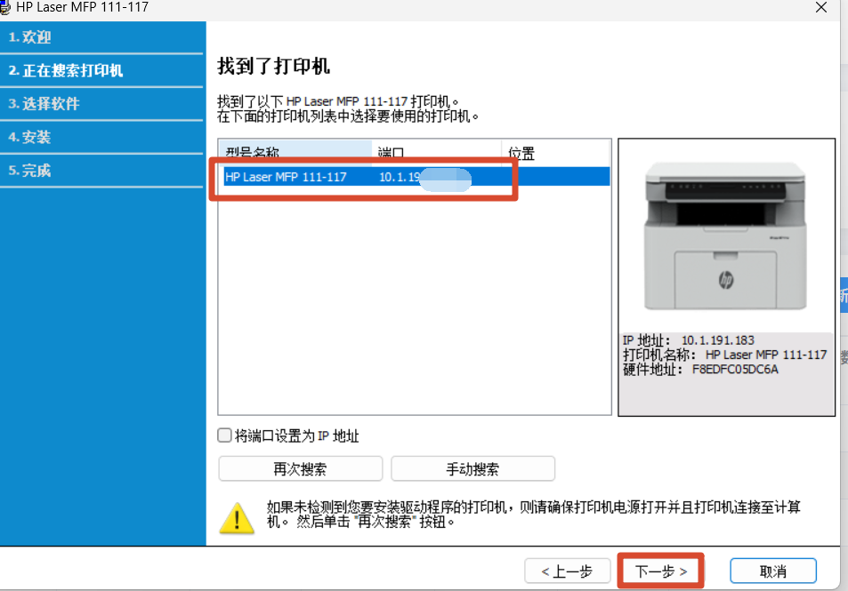

> 可以勾选「将端口设置为 IP 地址」，这样即使打印机 IP 变化也更容易管理。
> 如果搜索不到打印机，请确认打印机电源已打开、且与电脑在同一网络，然后点击「再次搜索」。

### 5. 选择要安装的软件和实用程序

进入「选择要安装的软件和实用程序」页面，安装类型保持「建议」，组件保持默认全选
（打印机器驱动程序、扫描驱动程序、HP MFP Scan），点击「下一步」开始安装：

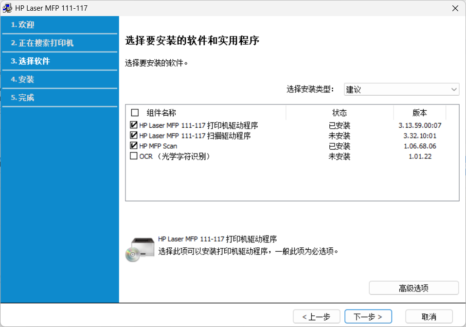

### 6. 完成安装

提示「安装完成」后，可以勾选「打印测试页」验证网络连接是否正常，
按需勾选「启用打印机状态监视器」，点击「完成」：

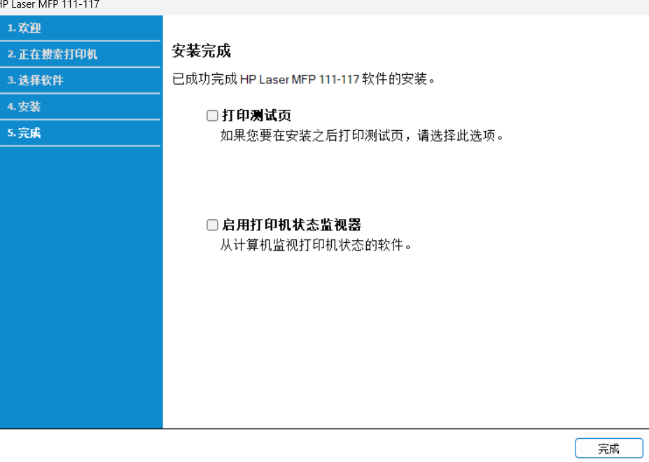
