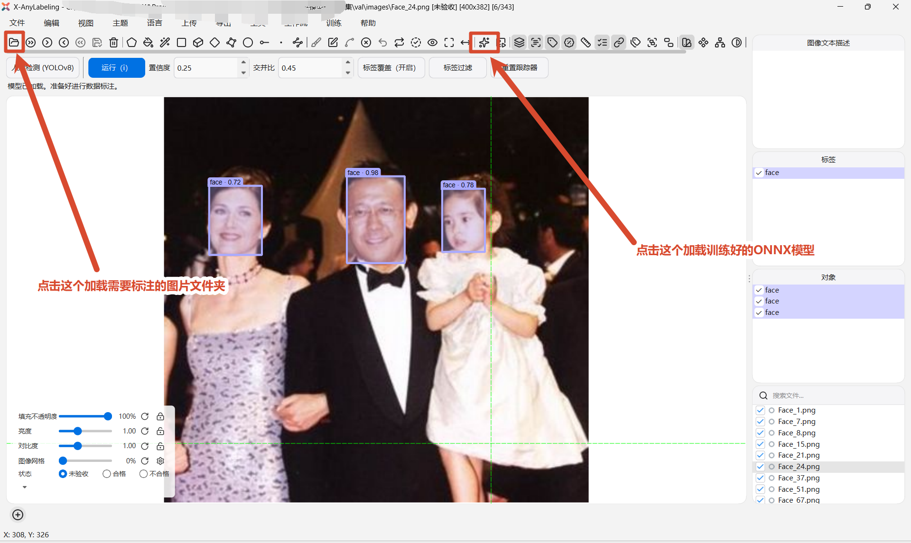

## 一、安装环境

安装 CUDA 11.8 版本的 PyTorch：

```bash
pip install torch torchvision --index-url https://download.pytorch.org/whl/cu118
```

安装 ultralytics：

```bash
pip install ultralytics
```

## 二、整体流程

| 步骤 | 说明 |
| ---- | ---- |
| 1 | 收集图片 |
| 2 | 标注 |
| 3 | 划分数据集（train/valid/test） |
| 4 | 写数据集 yaml |
| 5 | 写训练脚本 |
| 6 | 将训练好的 `best.pt` 权重转换为 `.onnx` 格式，用于推理 |

## 三、数据集目录结构（YOLO 标准结构）

```text
data/
├── train/            # 训练集（约 80~90%）
│   ├── images/       # .jpg 文件
│   └── labels/       # 同名 .txt
├── valid/            # 验证集（约 10%，训练中每轮评估用）
│   ├── images/
│   └── labels/
├── test/             # 测试集（约 10%，训练完最终评估用）
│   ├── images/
│   └── labels/
└── data.yaml         # 数据集配置文件（下一节写）
```

> 要点：
>
> - **images 和 labels 同名配对**：`xxx.jpg` ↔ `xxx.txt`
> - **三个集合的图片不能重复**，且要同分布（随机划分，不要按时间/场景切）
> - 划分比例参考 8:1:1

## 四、数据集配置文件

`data.yaml`（YOLO 数据集配置文件，Ultralytics）：

```yaml
# 用法: yolo train data=path/to/data.yaml model=yolov8n.pt epochs=100

path: .            # 数据集根目录（相对本文件所在目录，也可改为绝对路径）
train: train/images
val: val/images
test: test/images

# 类别数
nc: 1

# 类别名（与标签文件中的 class_id 对应，0 -> face）
names:
  0: face
```

## 五、训练代码

```python
from ultralytics import YOLO  # 导入YOLO模块

if __name__ == '__main__':
    # 加载YOLOv8的预训练模型（yolov8n.pt 已在当前目录）
    model = YOLO('yolov8n.pt')

    # 开始训练（相对路径：data.yaml 在当前目录，path: . 即当前目录）
    model.train(
        data='data.yaml',   # 数据集配置文件（相对当前运行目录）
        epochs=100,         # 训练轮数
        imgsz=640,          # 输入图片尺寸
        batch=16,           # 批次大小（显存不足可改为 8）
        workers=2,          # 数据加载线程数（Windows 下建议 2，避免多进程问题）
        device=0,           # 使用 GPU（没有 GPU 改为 'cpu'）
    )

    # 使用验证集验证效果
    model.val()
```

## 六、基本使用代码

```python
from ultralytics import YOLO  # 导入YOLO模块

# 加载训练好的模型
model = YOLO(r"runs/detect/train/weights/best.pt")

# 使用指定的图片进行预测
results = model.predict(r"test.png", classes=[0, 2])

# # 展示第一个预测结果
# if results:  # 确保结果列表不为空
#     results[0].show()


# 展示第一个预测结果
if results:  # 确保结果列表不为空
    results[0].save(filename=r"predict_result.png")
    print("结果已保存到 predict_result.png")
```

## 七、转换为 .onnx 格式

将 YOLOv8 的 `.pt` 权重转换为 `.onnx` 格式：

```python
# -*- coding: utf-8 -*-
from ultralytics import YOLO  # 导入YOLO模块

if __name__ == '__main__':
    # 加载训练好的权重
    model = YOLO('results_yolov8n_100e/kaggle/working/runs/detect/train/weights/best.pt')

    # 导出 ONNX（imgsz 需与训练时的输入尺寸一致）
    model.export(format='onnx', imgsz=640, simplify=True, opset=12)
```

## 八、X-AnyLabeling 使用 onnx 自定义模型

自定义模型配置文件（YOLOv8 人脸检测）：

```yaml
# 使用方法：X-AnyLabeling -> AI -> 加载自定义模型 -> 选择本文件

type: yolov8                 # 模型类型（固定为 yolov8，不要改）
name: yolov8n-face           # 模型内部名称（可自定义，勿与内置模型重名）
display_name: 人脸检测 (YOLOv8)   # 在 X-AnyLabeling 界面中显示的名称
provider: Ultralytics        # 推理后端（本地运行固定写 Ultralytics）

# ONNX 模型路径（相对于本 yaml 文件；X-AnyLabeling 会自动加载推理）
model_path: runs/detect/train/weights/best.onnx

conf_threshold: 0.25         # 置信度阈值（界面上也可调，低漏检调小、低误检调大）
iou_threshold: 0.45          # NMS 交并比阈值

# 类别列表（必须与训练时的 names 顺序完全一致，这里只有 1 类）
classes:
  - face
```

## 九、X-AnyLabeling 常用快捷键

| 功能 | 快捷键 |
| ---- | ---- |
| 上一张图片 | `A` |
| 下一张图片 | `D` |
| 矩形框标注 | `R` |
| 自动批量标注 | `Ctrl + B` |

使用 X-AnyLabeling 进行自动标注：



## 十、导出 classes.txt

导出为 yolo 格式标注需要的 `classes.txt`。

> 注意：请严格对照你训练模型时的 `data.yaml` 或当时的类别列表，这里仅作举例演示格式。

```text
face
```
